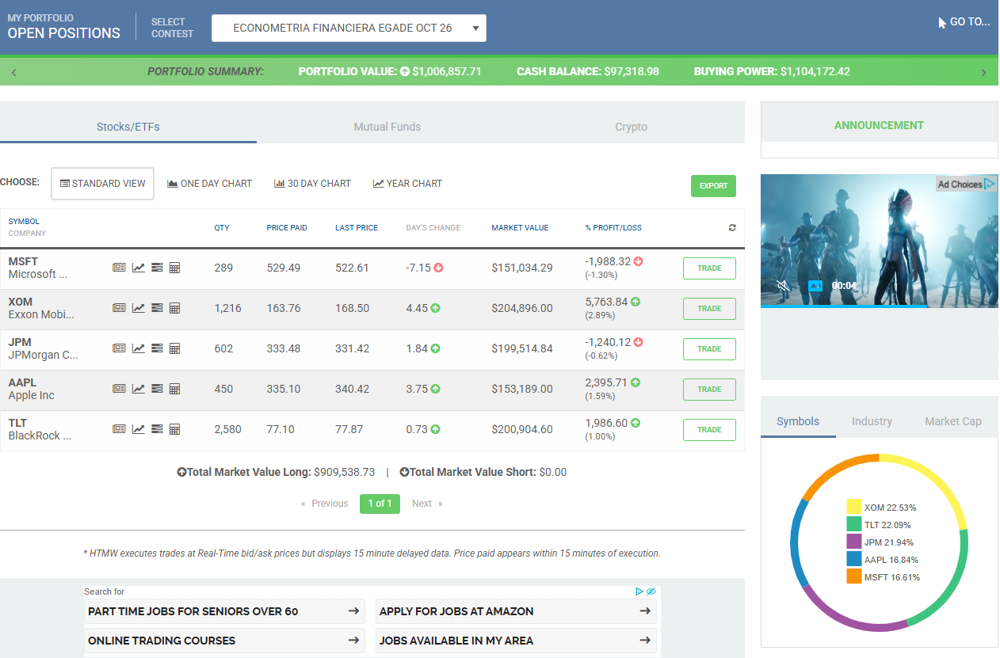
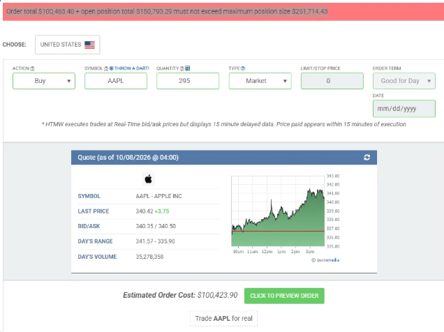
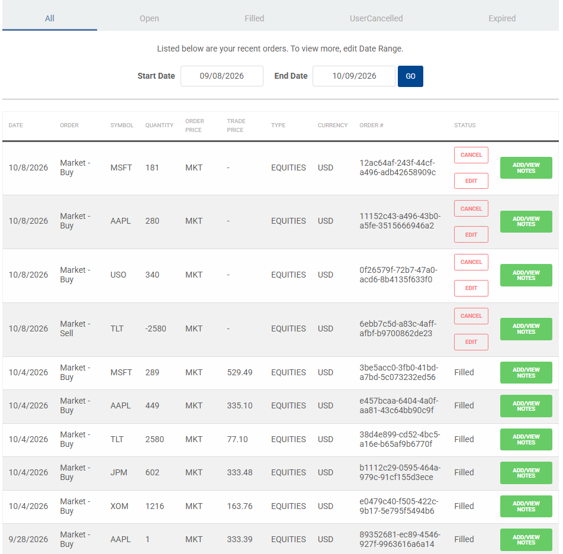

```{css, echo=FALSE}
#TOC::before {
  content: "Contenido";
  display: block;
  font-weight: bold;
  font-size: 1.3em;
  margin-bottom: 8px;
}
```

# Parte 1. Modelos de regresión múltiple con cinco variables independientes

Esta tarea tiene como objetivo estimar tres modelos de regresión lineal múltiple con cinco variables independientes cada uno, a partir de los modelos mt101, mt102 y mt103 de la Tarea 2 y de la Actividad 3. Cada modelo conserva su variable dependiente y sus tres variables independientes originales, y agrega dos variables nuevas, una del mismo sector o del mercado y otra de un activo distinto, con el fin de evaluar la relación entre las emisoras del portafolio en HowMarketsWork y apoyar la estrategia de inversión. Los modelos se estiman con rendimientos de 30 minutos descargados de LSEG Workspace, y en la Parte 2 se evalúa la violación de los supuestos de regresión lineal múltiple en cada uno de ellos.

## Periodo y frecuencia de los datos

De las alternativas que permite la tarea (datos de 1, 5 o 30 minutos de LSEG Refinitiv, o datos de mediano plazo con getSymbols), se eligieron datos de 30 minutos descargados de LSEG Workspace. La Actividad 3 mostró que, a 1 minuto, los modelos reflejan efectos de microestructura del mercado, como la autocorrelación negativa de los residuales y la menor correlación entre emisoras, que se reducen al ampliar el intervalo. Por ello, se eligió el intervalo más amplio de los permitidos.

El periodo comprende del 1 de julio al 7 de octubre de 2026, es decir, 69 sesiones completas, que eran las más recientes cerradas al momento de la descarga. Se eligieron alrededor de tres meses por dos razones. La primera es que corresponden al periodo más cercano a la operación del portafolio en HowMarketsWork, que inició el 5 de octubre, por lo que los resultados describen la relación actual entre sus activos. La segunda es que proporcionan alrededor de 830 rendimientos por modelo, una muestra similar a la de los modelos diarios de la Tarea 2 (940), suficiente para estimar seis parámetros y aplicar las pruebas de supuestos. Además, al abarcar 69 sesiones, se corrige la principal limitación de la Actividad 3, cuyos resultados dependían de solo dos días de operación.

## Selección de modelos y justificación de variables

Los tres modelos parten de los de la Tarea 2 y conservan su variable dependiente y sus tres variables independientes originales, cuya justificación se presentó en esa tarea y se resume a continuación. A cada modelo se le agregan dos variables con un criterio común. La primera incorpora un factor que en los modelos anteriores no se medía de forma directa, ya sea del mismo sector o de otra clase de activo, y la segunda incorpora un factor del mercado o de tasas de interés. Con esta selección, los cinco activos del portafolio en HowMarketsWork quedan incluidos en los modelos. Exxon, JPMorgan y Apple son las variables dependientes, mientras que Microsoft y TLT forman parte de las variables independientes, lo que permite evaluar la relación entre las posiciones del portafolio y apoyar la estrategia de la Parte 4.

### Modelo mt301: sector energía

xom_r = β0 + β1 cvx_r + β2 cop_r + β3 xle_r + β4 uso_r + β5 spy_r + ε

La variable dependiente es el rendimiento de Exxon Mobil (XOM). Como en la Tarea 2, se incluyen Chevron (CVX), su competidor directo con el mismo modelo de negocio integrado, ConocoPhillips (COP), productora dedicada a la exploración y producción, y el ETF del sector energético (XLE), todos con signo esperado positivo. La primera variable nueva es el ETF United States Oil Fund (USO), que replica el precio del petróleo crudo. En la Tarea 2 se señaló que el precio del petróleo es el factor común de las emisoras del sector, pero el modelo no lo medía de forma directa, sino a través de las otras emisoras. Al incluirlo, el modelo permite separar el efecto del precio del petróleo del efecto del sector, con un signo esperado positivo. La segunda variable nueva es el ETF SPDR S&P 500 (SPY), que representa al mercado en su conjunto y permite evaluar si Exxon responde al mercado además de a su sector, con un signo esperado positivo. Dado que XLE ya mostró multicolinealidad considerable en los modelos anteriores, y que USO y SPY también se relacionan con el sector, se anticipa nuevamente un problema de multicolinealidad en este modelo.

### Modelo mt302: sector financiero

jpm_r = β0 + β1 bac_r + β2 gs_r + β3 tlt_r + β4 c_r + β5 spy_r + ε

La variable dependiente es el rendimiento de JPMorgan Chase (JPM). Como en la Tarea 2, se incluyen Bank of America (BAC), su competidor en banca comercial, y Goldman Sachs (GS), que representa la banca de inversión, ambos con signo esperado positivo, así como el ETF de bonos del Tesoro de largo plazo (TLT), con signo esperado negativo, ya que el alza de tasas de interés suele ampliar el margen financiero de los bancos. La primera variable nueva es Citigroup (C), un banco universal que, al igual que JPMorgan, combina la banca comercial con la de inversión, por lo que se espera un signo positivo. La segunda variable nueva es SPY, que permite medir la sensibilidad de JPMorgan al mercado en general, más allá de su relación con los otros bancos, con un signo esperado positivo. Se anticipa una correlación alta entre Citigroup y Bank of America, que podría generar multicolinealidad.

### Modelo mt303: sector tecnología

aapl_r = β0 + β1 msft_r + β2 nvda_r + β3 spy_r + β4 tsm_r + β5 tlt_r + ε

La variable dependiente es el rendimiento de Apple (AAPL). Como en la Tarea 2, se incluyen Microsoft (MSFT), su par más cercano en tamaño, Nvidia (NVDA), que representa el ciclo de semiconductores e inteligencia artificial, y SPY, que incorpora el riesgo de mercado, todos con signo esperado positivo. La primera variable nueva es Taiwan Semiconductor Manufacturing (TSM), el fabricante de los chips que utiliza Apple en sus productos. En los modelos anteriores, una parte importante del rendimiento de Apple dependía de factores propios de la empresa, por lo que se incluye a su principal proveedor para evaluar si Apple se mueve con su cadena de suministro, con un signo esperado positivo. La segunda variable nueva es TLT. El valor de las empresas de tecnología depende en buena medida de sus flujos futuros, por lo que suele ser sensible a las tasas de interés de largo plazo. Cuando las tasas bajan, el precio de TLT sube y el valor presente de esos flujos aumenta, por lo que se espera un signo positivo. Como las correlaciones entre las variables de este modelo fueron moderadas en los ejercicios anteriores, no se anticipa un problema importante de multicolinealidad.

## Carga y tratamiento de los datos

Paso 1. Carga de librerías: readxl para leer el archivo de Excel, quantmod para manejar series de tiempo y calcular rendimientos, car para el VIF, lmtest para las pruebas de heterocedasticidad y autocorrelación, tseries para la prueba de normalidad de Jarque-Bera y sandwich para los errores estándar de Newey-West.

```{r, message=FALSE}
library(readxl)
library(quantmod)
library(car)
library(lmtest)
library(tseries)
library(sandwich)
```

Paso 2. Lectura de la hoja de Excel con los precios de 30 minutos descargados de LSEG Workspace. Se omite la primera fila (skip = 1), que solo contiene la hora de actualización de la descarga.

```{r, message=FALSE}
archivo <- "Tarea3_A01452205_datosLSEG.xlsx"
min30 <- read_excel(archivo, sheet = "30min_valores", skip = 1)
dim(min30)
head(min30[, 1:2])
head(min30[, 57:58])
```

Resultado: la hoja contiene 966 filas, que corresponden al bloque con más barras, y 58 columnas, que agrupan la fecha-hora y el precio de cierre de las quince emisoras. La verificación del primer bloque (Apple) y del último (TSMC) confirma que ambos inician el 1 de julio de 2026 a las 10:00, con la barra que corresponde al intervalo de 9:30 a 10:00.

Paso 3. Creación de las series de precios de cierre de 30 minutos. Se utiliza la misma función de la Actividad 3, que toma el bloque de cada emisora, elimina las filas vacías al final del bloque y convierte los precios en una serie de tiempo (xts) ordenada por fecha-hora.

```{r}
crear_serie <- function(datos, col) {
  bloque <- na.omit(as.data.frame(datos[, c(col, col + 1)]))
  xts(bloque[[2]], order.by = bloque[[1]])
}

aapl_30m <- crear_serie(min30, 1)
msft_30m <- crear_serie(min30, 5)
nvda_30m <- crear_serie(min30, 9)
spy_30m  <- crear_serie(min30, 13)
xom_30m  <- crear_serie(min30, 17)
cvx_30m  <- crear_serie(min30, 21)
cop_30m  <- crear_serie(min30, 25)
xle_30m  <- crear_serie(min30, 29)
jpm_30m  <- crear_serie(min30, 33)
bac_30m  <- crear_serie(min30, 37)
gs_30m   <- crear_serie(min30, 41)
tlt_30m  <- crear_serie(min30, 45)
uso_30m  <- crear_serie(min30, 49)
c_30m    <- crear_serie(min30, 53)
tsm_30m  <- crear_serie(min30, 57)

c(nrow(aapl_30m), nrow(msft_30m), nrow(nvda_30m), nrow(spy_30m),
  nrow(xom_30m), nrow(cvx_30m), nrow(cop_30m), nrow(xle_30m),
  nrow(jpm_30m), nrow(bac_30m), nrow(gs_30m), nrow(tlt_30m),
  nrow(uso_30m), nrow(c_30m), nrow(tsm_30m))
```

Resultado: las quince series se crearon con el número de barras esperado. Las diferencias entre emisoras se deben únicamente a las barras posteriores al cierre de las 16:00, que LSEG registra en algunos días. Todas las emisoras tienen las 897 barras del horario regular (69 sesiones de 13 barras), por lo que, a diferencia de la frecuencia de 1 minuto de la Actividad 3, no hay intervalos sin operaciones en ninguna emisora. Las barras posteriores al cierre se eliminan al construir la base de cada modelo.

## Modelo mt301: Exxon (energía)

### Construcción de la base y cálculo de rendimientos

Se unen los precios de cierre de las seis emisoras por fecha y hora, conservando solo los intervalos en los que todas tienen precio, y se conserva el horario regular de operación (barras de 10:00 a 16:00). Después se calculan los rendimientos de cada intervalo y se elimina el primer rendimiento de cada día, que mide el cambio entre el cierre del día anterior y la primera barra del día, y no corresponde a un intervalo de 30 minutos.

```{r}
base301 <- na.omit(merge(xom_30m, cvx_30m, cop_30m, xle_30m, uso_30m, spy_30m))
colnames(base301) <- c("xom", "cvx", "cop", "xle", "uso", "spy")
base301 <- base301["T10:00/T16:00"]
nrow(base301)

r301 <- ROC(base301, type = "discrete")

dia <- as.Date(index(base301))
mismo_dia <- c(FALSE, dia[-1] == dia[-length(dia)])
r301 <- r301[mismo_dia]

colnames(r301) <- c("xom_r", "cvx_r", "cop_r", "xle_r", "uso_r", "spy_r")
nrow(r301)
head(r301)

mt301_df <- as.data.frame(r301)
```

La base del modelo contiene 897 observaciones, ya que las seis emisoras tienen precio en todas las barras del horario regular y la unión no eliminó ningún intervalo. Después de eliminar el primer rendimiento de cada una de las 69 sesiones, quedan 828 rendimientos de 30 minutos.

### Matriz de correlación

```{r}
round(cor(mt301_df), 2)
```

Los rendimientos de Exxon tienen una correlación alta con XLE (0.85), Chevron (0.81) y ConocoPhillips (0.73), niveles cercanos a los de los datos diarios de la Tarea 2 y superiores a los de 1 minuto de la Actividad 3. Su correlación con el precio del petróleo (USO) es moderada (0.52), y con el mercado (SPY) es ligeramente negativa (−0.13), por lo que, en este periodo y en intervalos de 30 minutos, Exxon tuvo una relación débil con el mercado. Entre las variables explicativas, las correlaciones más altas son las de XLE con Chevron (0.88) y con ConocoPhillips (0.85), por lo que se anticipa nuevamente un problema de multicolinealidad concentrado en XLE. USO se correlaciona en alrededor de 0.53 con las emisoras del sector, y SPY tiene correlaciones negativas con todas, en especial con USO (−0.31).

### Regresión múltiple

```{r}
mt301 <- lm(xom_r ~ cvx_r + cop_r + xle_r + uso_r + spy_r, data = mt301_df)
summary(mt301)
```

Residuales. La mediana de los residuales es prácticamente cero y los cuartiles son simétricos (−0.00088 y 0.00083). Los valores extremos (−0.57% y 0.70%) tienen magnitudes parecidas, por lo que el modelo no sobreestima ni subestima de forma sistemática el rendimiento de Exxon.

Significancia de los coeficientes. XLE sigue siendo la variable dominante (p-value < 0.001). Manteniendo constantes las demás variables, cuando el rendimiento de XLE aumenta un punto porcentual en un intervalo de 30 minutos, el de Exxon aumenta en promedio 0.66 puntos. Chevron también es altamente significativa (p-value < 0.001), con un coeficiente de 0.28, mayor que en los modelos diario y de 1 minuto. ConocoPhillips no es significativa (p-value = 0.96) y su coeficiente es prácticamente cero, el mismo resultado que en el modelo diario de la Tarea 2. En cuanto a las variables nuevas, el precio del petróleo (USO) es significativo al 5% (p-value = 0.03) y tiene el signo positivo esperado, pero su efecto es pequeño. Un aumento de un punto porcentual en USO se asocia con un aumento de apenas 0.03 puntos en Exxon, ya que la mayor parte del efecto del petróleo ya está contenida en XLE y en Chevron. El mercado (SPY) no es significativo al 5% (p-value = 0.09) y su coeficiente es negativo (−0.07), contrario al signo positivo esperado, lo que es consistente con su correlación negativa con Exxon en este periodo. El intercepto no es significativo (p-value = 0.72).

Significancia del modelo. El estadístico F (468.1, p-value < 2.2e-16) indica que el modelo es significativo en su conjunto. Explica alrededor del 74% de la variación del rendimiento de Exxon (R cuadrada = 0.740; R cuadrada ajustada = 0.739), un ajuste entre el del modelo de 1 minuto de la Actividad 3 (0.70) y el del modelo diario de la Tarea 2 (0.81). El error estándar residual de 0.00146 indica que el modelo se equivoca típicamente en ±0.15% por intervalo de 30 minutos.

### Intervalos de confianza

```{r}
confint(mt301, level = 0.95)
```

Los intervalos de confianza al 95% de XLE (0.56, 0.76) y de Chevron (0.19, 0.36) excluyen el cero, y el de XLE también excluye el uno, por lo que Exxon se mueve en una proporción menor que el sector, igual que en los modelos anteriores. El intervalo de USO (0.003, 0.056) apenas excluye el cero, lo que confirma que su efecto es positivo pero de magnitud muy reducida. En términos de Gujarati, es un coeficiente estadísticamente significativo con poca relevancia práctica. Los intervalos de ConocoPhillips (−0.06, 0.06), SPY (−0.15, 0.01) y el intercepto incluyen el cero, por lo que no puede descartarse que su efecto sea nulo.

## Modelo mt302: JPMorgan (financiero)

### Construcción de la base y cálculo de rendimientos

Se sigue el mismo procedimiento que en el modelo mt301.

```{r}
base302 <- na.omit(merge(jpm_30m, bac_30m, gs_30m, tlt_30m, c_30m, spy_30m))
colnames(base302) <- c("jpm", "bac", "gs", "tlt", "c", "spy")
base302 <- base302["T10:00/T16:00"]
nrow(base302)

r302 <- ROC(base302, type = "discrete")

dia <- as.Date(index(base302))
mismo_dia <- c(FALSE, dia[-1] == dia[-length(dia)])
r302 <- r302[mismo_dia]

colnames(r302) <- c("jpm_r", "bac_r", "gs_r", "tlt_r", "c_r", "spy_r")
nrow(r302)
head(r302)

mt302_df <- as.data.frame(r302)
```

La base del modelo contiene 897 observaciones y 828 rendimientos de 30 minutos, ya que las seis emisoras tienen precio en todas las barras del horario regular.

### Matriz de correlación

```{r}
round(cor(mt302_df), 2)
```

Los rendimientos de JPMorgan tienen su correlación más alta con Bank of America (0.72), seguida de Citigroup (0.69) y Goldman Sachs (0.64), lo que confirma que los grandes bancos responden a factores comunes. Su correlación con el mercado (SPY) es moderada (0.35), y con TLT es baja y positiva (0.22), a diferencia del −0.06 diario de la Tarea 2. Entre las variables explicativas, Citigroup se correlaciona en 0.66 con Bank of America y con Goldman Sachs, y Goldman Sachs en 0.53 con SPY. Son correlaciones moderadas, menores a las que generaron multicolinealidad en el modelo de energía, por lo que no se anticipa un problema grave, aunque el VIF de los bancos será mayor que en el modelo de la Tarea 2.

### Regresión múltiple

```{r}
mt302 <- lm(jpm_r ~ bac_r + gs_r + tlt_r + c_r + spy_r, data = mt302_df)
summary(mt302)
```

Residuales. La mediana de los residuales es prácticamente cero y los cuartiles son simétricos (−0.00088 y 0.00077). Sin embargo, el valor máximo (1.71%) es tres veces mayor en valor absoluto que el mínimo (−0.57%), lo que indica que hubo al menos un intervalo en el que JPMorgan subió mucho más de lo que el modelo estimaba.

Significancia de los coeficientes. Los tres bancos son altamente significativos (p-value < 0.001) y tienen el signo positivo esperado. Manteniendo constantes las demás variables, cuando el rendimiento de Bank of America aumenta un punto porcentual en un intervalo de 30 minutos, el de JPMorgan aumenta en promedio 0.37 puntos, seguido de Citigroup (0.18) y Goldman Sachs (0.17). La nueva variable, Citigroup, aporta información adicional a la de los otros dos bancos, y su efecto es similar al de Goldman Sachs, lo que es consistente con que ambos combinan banca comercial y de inversión. En cambio, TLT no es significativa (p-value = 0.12) y su coeficiente es positivo (0.08), contrario al signo negativo esperado y al resultado diario de la Tarea 2 (−0.16). El mercado (SPY) tampoco es significativo (p-value = 0.42) y su coeficiente es negativo (−0.04), contrario a lo esperado. Esto indica que, una vez que se consideran los movimientos de los otros tres bancos, el mercado no aporta información adicional sobre JPMorgan. El intercepto no es significativo al 5% (p-value = 0.09).

Significancia del modelo. El estadístico F (287.3, p-value < 2.2e-16) indica que el modelo es significativo en su conjunto. Explica alrededor del 64% de la variación del rendimiento de JPMorgan (R cuadrada = 0.636; R cuadrada ajustada = 0.634), un ajuste similar al del modelo diario de la Tarea 2 (0.65) y mayor que el de los modelos de 1 y 5 minutos de la Actividad 3 (0.57 y 0.55). El error estándar residual de 0.00157 indica que el modelo se equivoca típicamente en ±0.16% por intervalo de 30 minutos.

### Intervalos de confianza

```{r}
confint(mt302, level = 0.95)
```

Los intervalos de confianza al 95% de Bank of America (0.32, 0.42), Goldman Sachs (0.13, 0.21) y Citigroup (0.13, 0.22) excluyen el cero, por lo que los tres efectos son claramente positivos. El intervalo de Bank of America no incluye su coeficiente diario de la Tarea 2 (0.46), aunque la comparación debe tomarse con cautela, ya que en este modelo parte del efecto común de los bancos se reparte con Citigroup. El intervalo de TLT (−0.02, 0.18) incluye el cero y excluye el coeficiente diario (−0.16), por lo que en este periodo y frecuencia no se observa el efecto de las tasas de interés sobre JPMorgan. Los intervalos de SPY (−0.14, 0.06) y del intercepto también incluyen el cero.

## Modelo mt303: Apple (tecnología)

### Construcción de la base y cálculo de rendimientos

Se sigue el mismo procedimiento que en los modelos anteriores.

```{r}
base303 <- na.omit(merge(aapl_30m, msft_30m, nvda_30m, spy_30m, tsm_30m, tlt_30m))
colnames(base303) <- c("aapl", "msft", "nvda", "spy", "tsm", "tlt")
base303 <- base303["T10:00/T16:00"]
nrow(base303)

r303 <- ROC(base303, type = "discrete")

dia <- as.Date(index(base303))
mismo_dia <- c(FALSE, dia[-1] == dia[-length(dia)])
r303 <- r303[mismo_dia]

colnames(r303) <- c("aapl_r", "msft_r", "nvda_r", "spy_r", "tsm_r", "tlt_r")
nrow(r303)
head(r303)

mt303_df <- as.data.frame(r303)
```

La base del modelo contiene 897 observaciones y 828 rendimientos de 30 minutos, ya que las seis emisoras tienen precio en todas las barras del horario regular.

### Matriz de correlación

```{r}
round(cor(mt303_df), 2)
```

Como en los ejercicios anteriores, la correlación más alta de Apple es con el mercado (SPY, 0.32), mientras que con Microsoft (0.19), TLT (0.16) y Nvidia (0.09) es baja, y con TSMC es prácticamente nula (−0.02). Entre las variables explicativas, en cambio, destacan las correlaciones de SPY con Nvidia (0.67) y con TSMC (0.62), y la de Nvidia con TSMC (0.57), por lo que las emisoras de semiconductores se mueven de forma cercana entre sí y con el mercado. Estas correlaciones son moderadas, por lo que podría presentarse multicolinealidad moderada asociada a SPY, aunque no se anticipa un problema.

### Regresión múltiple

```{r}
mt303 <- lm(aapl_r ~ msft_r + nvda_r + spy_r + tsm_r + tlt_r, data = mt303_df)
summary(mt303)
```

Residuales. La mediana de los residuales es prácticamente cero y los cuartiles son simétricos (−0.0015 y 0.0014). Los valores extremos (−1.16% y 1.45%) tienen magnitudes parecidas, aunque son los mayores de los tres modelos, lo que refleja que Apple tiene movimientos propios más amplios que Exxon y JPMorgan.

Significancia de los coeficientes. El mercado es la variable dominante (p-value < 0.001). Manteniendo constantes las demás variables, cuando el rendimiento de SPY aumenta un punto porcentual en un intervalo de 30 minutos, el de Apple aumenta en promedio 1.35 puntos, una sensibilidad mayor a uno, como en el modelo diario de la Tarea 2 (1.17). Nvidia es significativa (p-value = 0.002) con un coeficiente negativo (−0.10), el mismo resultado que en el modelo diario. La variable nueva TSMC también es altamente significativa (p-value < 0.001), pero con un coeficiente negativo (−0.23), contrario al signo positivo esperado. Como su correlación simple con Apple es prácticamente nula, este resultado no indica que se muevan en sentidos opuestos, sino que, para un mismo movimiento del mercado, cuando las emisoras de semiconductores (Nvidia y TSMC) suben más que el mercado, Apple tiende a quedarse atrás. Microsoft (p-value = 0.83) y la otra variable nueva, TLT (p-value = 0.86), no son significativas, por lo que no aportan información adicional sobre Apple una vez que se considera el mercado. A diferencia de los otros dos modelos, el intercepto es significativo (p-value = 0.008), lo que indica que en este periodo Apple tuvo un rendimiento promedio positivo por intervalo, de alrededor de 0.03%, que no se explica por las variables del modelo.

Significancia del modelo. El estadístico F (36.99, p-value < 2.2e-16) indica que el modelo es significativo en su conjunto. Sin embargo, explica solo alrededor del 18% de la variación del rendimiento de Apple (R cuadrada = 0.184; R cuadrada ajustada = 0.179). Es el ajuste más bajo de los tres modelos, aunque mayor que el de los modelos de 1 y 5 minutos de la Actividad 3 (0.13 y 0.04). El error estándar residual de 0.00278 indica que el modelo se equivoca típicamente en ±0.28% por intervalo de 30 minutos.

### Intervalos de confianza

```{r}
confint(mt303, level = 0.95)
```

El intervalo de confianza al 95% de SPY (1.11, 1.58) excluye el uno, por lo que Apple amplifica los movimientos del mercado. El coeficiente diario de la Tarea 2 (1.17) queda dentro de este intervalo, por lo que la sensibilidad de Apple al mercado a 30 minutos es estadísticamente similar a la diaria. Los intervalos de Nvidia (−0.17, −0.04) y de TSMC (−0.29, −0.17) son completamente negativos, lo que confirma su efecto negativo una vez que se controla por el mercado. Los intervalos de Microsoft (−0.06, 0.07) y de TLT (−0.17, 0.20) incluyen el cero. El intervalo del intercepto (0.00007, 0.00045) es completamente positivo, lo que confirma el rendimiento propio de Apple en el periodo.

## Conclusión de la Parte 1

Los tres modelos con cinco variables independientes son significativos en su conjunto, y su ajuste sigue el mismo orden que en los ejercicios anteriores. El modelo de energía es el que mejor explica a su variable dependiente (R cuadrada de 0.74), seguido del financiero (0.64) y del de tecnología (0.18). En los tres casos, las variables originales que resultaron dominantes en la Tarea 2 lo siguen siendo con datos de 30 minutos. XLE en el caso de Exxon, los bancos en el caso de JPMorgan y el mercado en el caso de Apple, cuya sensibilidad es estadísticamente similar a la diaria.

Las variables nuevas tuvieron resultados distintos. Citigroup aporta información adicional sobre JPMorgan, con un efecto similar al de Goldman Sachs. El precio del petróleo (USO) es significativo, pero su efecto sobre Exxon es muy pequeño, porque la mayor parte ya está contenida en XLE y en Chevron. TSMC es significativa, pero con un signo negativo contrario al esperado, lo que indica que Apple tiende a quedarse atrás cuando las emisoras de semiconductores suben más que el mercado. En cambio, SPY no es significativo en los modelos de Exxon y JPMorgan, y TLT no lo es en ninguno de los dos modelos en los que se incluyó.

Estos resultados tienen implicaciones directas para el portafolio. En este periodo, Exxon tuvo una relación débil y ligeramente negativa con el mercado (correlación de −0.13), lo que la convierte en una fuente de diversificación frente a las posiciones de tecnología. Apple amplifica los movimientos del mercado y casi no se relaciona con Microsoft. Y TLT, que en la estrategia inicial se incluyó como contrapeso por su efecto negativo sobre JPMorgan en los datos diarios, no mostró ese efecto ni sobre JPMorgan ni sobre Apple en intervalos de 30 minutos. Estas conclusiones se retoman en la estrategia de la Parte 4, una vez evaluados los supuestos de cada modelo en la Parte 2.

# Parte 2. Detección de violación de supuestos y corrección

El modelo de regresión lineal clásico supone, entre otras condiciones, que la varianza del término de error es constante (homocedasticidad), que los errores de distintas observaciones no están relacionados entre sí (no autocorrelación), que ninguna variable explicativa es una combinación lineal exacta de las demás (no multicolinealidad perfecta) y que el término de error se distribuye normalmente. Cuando estos supuestos se cumplen, los estimadores de mínimos cuadrados ordinarios son los mejores estimadores lineales insesgados (MELI).

En esta parte se evalúa si los tres modelos de la Parte 1 cumplen estos supuestos. En las pruebas utilizadas, la hipótesis nula corresponde al cumplimiento del supuesto, por lo que rechazarla implica detectar su violación. Se evalúan la multicolinealidad con el factor de inflación de la varianza (VIF), la heterocedasticidad con las pruebas de Breusch-Pagan y Goldfeld-Quandt, la autocorrelación con las pruebas de Durbin-Watson y Breusch-Godfrey, y la normalidad de los residuos con su histograma y la prueba de Jarque-Bera. En sentido estricto, el supuesto del modelo clásico solo excluye la multicolinealidad perfecta, por lo que una multicolinealidad alta pero imperfecta se trata como un problema de los datos que infla los errores estándar, y no como una violación del supuesto.

Cuando se detecta un problema, se aplica una corrección. La multicolinealidad se corrige eliminando la variable que la concentra, como en la Tarea 2. La heterocedasticidad y la autocorrelación no sesgan los coeficientes, pero sí sus errores estándar, por lo que se corrigen con los errores estándar de Newey-West, que de acuerdo con Gujarati (capítulo 12, sección 12.10) son consistentes con ambos problemas y son adecuados para muestras grandes, como las de estos modelos.

## Modelo mt301

### Multicolinealidad (VIF)

```{r}
vif(mt301)
```

El VIF de XLE es de 6.79, superior al umbral de 5, lo que indica multicolinealidad considerable. El error estándar de su coeficiente es aproximadamente 2.6 veces mayor al que tendría sin multicolinealidad. Chevron (4.61) se encuentra cerca del umbral y ConocoPhillips (3.60) presenta multicolinealidad moderada, mientras que las dos variables nuevas tienen VIF bajos (USO 1.62 y SPY 1.13), por lo que no comparten mucha información con las demás. Como en la Tarea 2 y en el modelo de 5 minutos de la Actividad 3, la multicolinealidad se concentra en XLE, por lo que se corrige más adelante en esta sección.

### Heterocedasticidad

```{r}
bptest(mt301)
gqtest(mt301)
```

El test de Breusch-Pagan (BP = 5.49, p-value = 0.36) no rechaza la hipótesis nula de homocedasticidad, por lo que la varianza de los errores no se relaciona con las variables explicativas. El contraste de Goldfeld-Quandt (GQ = 0.95, p-value = 0.69) tampoco la rechaza, y su estadístico, muy cercano a uno, indica que la varianza de los residuales es prácticamente la misma en la primera y en la segunda mitad del periodo. Ambas pruebas coinciden en que el modelo no presenta heterocedasticidad.

### Autocorrelación

```{r}
dwtest(mt301)
dwtest(mt301, alternative = "two.sided")
bgtest(mt301, order = 5)
```

La prueba de Durbin-Watson arroja un estadístico de 1.97, prácticamente igual a 2, y ni la prueba de una cola (p-value = 0.35) ni la de dos colas (p-value = 0.70) rechazan la hipótesis nula de no autocorrelación. La prueba de Breusch-Godfrey de orden 5 (LM = 2.17, p-value = 0.83) tampoco la rechaza. El modelo no presenta autocorrelación, a diferencia del modelo de 1 minuto de la Actividad 3, lo que confirma que, en intervalos de 30 minutos, los efectos de microestructura que la generaban ya no se observan.

### Normalidad de los residuos

```{r}
hist(residuals(mt301), breaks = 40, main = "Residuos del modelo mt301", xlab = "Residuos", col = "grey")
jarque.bera.test(residuals(mt301))
```

El histograma muestra residuos centrados en cero, con una forma cercana a la de una campana, aunque con más observaciones en el centro y algunos valores extremos en ambas colas. La prueba de Jarque-Bera (X-squared = 61.58, p-value < 0.001) rechaza la hipótesis de normalidad. Como señala Gujarati, la normalidad del error es necesaria para que las pruebas t y F sean exactas en muestras pequeñas, pero con 828 observaciones la muestra es suficientemente grande para que estas pruebas sigan siendo aproximadamente válidas.

### Corrección de multicolinealidad

La multicolinealidad se concentra en XLE (VIF de 6.79), por lo que se elimina esta variable por las mismas razones de la Tarea 2. La razón estadística es que tiene el VIF más alto, y la económica es que XLE replica al sector energético, del que forman parte Exxon y Chevron, por lo que el modelo estaría explicando en parte el rendimiento de Exxon con su propio rendimiento. El modelo corregido (mt301b) conserva cuatro variables independientes, mientras que el modelo propuesto y estimado originalmente cumple con las cinco variables solicitadas.

```{r}
mt301b <- lm(xom_r ~ cvx_r + cop_r + uso_r + spy_r, data = mt301_df)
summary(mt301b)
confint(mt301b, level = 0.95)
vif(mt301b)
```

Residuales. La mediana de los residuales es prácticamente cero y los cuartiles son simétricos (−0.00099 y 0.00094). Los valores extremos (−0.69% y 0.82%) tienen magnitudes parecidas, por lo que el modelo corregido no sobreestima ni subestima de forma sistemática el rendimiento de Exxon.

Significancia de los coeficientes. Al eliminar XLE, tres de las cuatro variables son altamente significativas (p-value < 0.001) y tienen el signo positivo esperado. Manteniendo constantes las demás variables, cuando el rendimiento de Chevron aumenta un punto porcentual en un intervalo de 30 minutos, el de Exxon aumenta en promedio 0.64 puntos, y en el caso de ConocoPhillips, 0.21 puntos. Como en la Tarea 2, ConocoPhillips pasa de un coeficiente no significativo a uno positivo y significativo, lo que confirma que su información estaba siendo absorbida por XLE. El efecto del precio del petróleo (USO) se duplica, de 0.03 a 0.06, y su significancia aumenta (p-value < 0.001), ya que una parte de su efecto también estaba contenida en XLE. Aun así, su magnitud sigue siendo pequeña frente a la de Chevron. El mercado (SPY) sigue sin ser significativo (p-value = 0.95) y su coeficiente es prácticamente cero. El intercepto no es significativo (p-value = 0.85).

Significancia del modelo. El estadístico F (452.6, p-value < 2.2e-16) indica que el modelo es significativo en su conjunto. La R cuadrada baja de 0.740 a 0.688, por lo que el modelo corregido explica alrededor de 5 puntos porcentuales menos de la variación de Exxon, una pérdida intermedia entre la del modelo diario de la Tarea 2 (7.5 puntos) y la del modelo de 5 minutos de la Actividad 3 (4 puntos). El error estándar residual de 0.0016 indica que el modelo se equivoca típicamente en ±0.16% por intervalo de 30 minutos.

Los intervalos de confianza al 95% de Chevron (0.57, 0.70), ConocoPhillips (0.15, 0.26) y USO (0.03, 0.09) excluyen el cero, por lo que los tres efectos son claramente positivos. El intervalo de Chevron excluye su coeficiente del modelo corregido diario (0.52) y el de ConocoPhillips excluye el suyo (0.33), por lo que, a 30 minutos, Exxon se mueve más con Chevron y menos con ConocoPhillips que en datos diarios, aunque la comparación debe tomarse con cautela porque el modelo diario no incluía a USO ni a SPY. Los intervalos de SPY (−0.08, 0.09) y del intercepto incluyen el cero.

Los VIF de las cuatro variables están por debajo de 3 (Chevron 2.54, ConocoPhillips 2.60, USO 1.57 y SPY 1.11), por lo que la corrección eliminó el problema de multicolinealidad. En conclusión, eliminar XLE sacrificó una parte de la capacidad explicativa del modelo, pero produjo coeficientes significativos, con el signo esperado y sin multicolinealidad. El modelo mt301b es el que se utiliza en la corrección con errores estándar de Newey-West y en la estrategia de la Parte 4.

## Modelo mt302

### Multicolinealidad (VIF)

```{r}
vif(mt302)
```

Los VIF de las cinco variables son bajos (Citigroup 2.30, Goldman Sachs 2.20, Bank of America 1.89, SPY 1.54 y TLT 1.19), todos por debajo del umbral de 5, por lo que el modelo no presenta multicolinealidad y no requiere corrección. Aunque se anticipaba una correlación alta entre Citigroup y Bank of America, su nivel (0.66) no fue suficiente para generar un problema, y los VIF de los bancos son solo ligeramente mayores que en el modelo diario de la Tarea 2 (alrededor de 1.9).

### Heterocedasticidad

```{r}
bptest(mt302)
gqtest(mt302)
```

El test de Breusch-Pagan (BP = 18.06, p-value = 0.003) rechaza la hipótesis nula de homocedasticidad, por lo que la varianza de los errores se relaciona con los valores de las variables explicativas. Es el mismo resultado que en el modelo diario de la Tarea 2 y en los modelos de 1 y 5 minutos de la Actividad 3, por lo que la heterocedasticidad es una característica estable del modelo financiero en todas las frecuencias. El contraste de Goldfeld-Quandt (GQ = 1.11, p-value = 0.16) no la rechaza, por lo que la varianza no difiere entre la primera y la segunda mitad del periodo. En conjunto, la heterocedasticidad no se presenta a lo largo del tiempo, sino en relación con la magnitud de los movimientos de los bancos y del mercado. Esto no sesga los coeficientes, pero sí resta confiabilidad a sus errores estándar y p-values, por lo que se corrige más adelante con los errores estándar de Newey-West.

### Autocorrelación

```{r}
dwtest(mt302)
dwtest(mt302, alternative = "two.sided")
bgtest(mt302, order = 5)
```

La prueba de Durbin-Watson arroja un estadístico de 1.99, prácticamente igual a 2, y ni la prueba de una cola (p-value = 0.43) ni la de dos colas (p-value = 0.85) rechazan la hipótesis nula de no autocorrelación. La prueba de Breusch-Godfrey de orden 5 (LM = 5.74, p-value = 0.33) tampoco la rechaza. El modelo no presenta autocorrelación.

### Normalidad de los residuos

```{r}
hist(residuals(mt302), breaks = 40, main = "Residuos del modelo mt302", xlab = "Residuos", col = "grey")
jarque.bera.test(residuals(mt302))
```

El histograma muestra residuos centrados en cero, con un pico más alto que el de una distribución normal y un valor extremo aislado cercano a 1.7%, que corresponde al residual máximo identificado en la Parte 1. La prueba de Jarque-Bera (X-squared = 11,611, p-value < 0.001) rechaza con mucha fuerza la hipótesis de normalidad. El estadístico es mucho mayor que el del modelo de energía (61.6), lo que se explica principalmente por ese valor extremo, ya que la prueba es muy sensible a las colas de la distribución. Con 828 observaciones, las pruebas t y F siguen siendo aproximadamente válidas, pero la combinación de heterocedasticidad y de un valor extremo refuerza la conveniencia de corregir los errores estándar.

## Modelo mt303

### Multicolinealidad (VIF)

```{r}
vif(mt303)
```

Los VIF de las cinco variables están por debajo del umbral de 5, por lo que el modelo no presenta multicolinealidad y no requiere corrección. El valor más alto corresponde a SPY (2.88), por su correlación con Nvidia (0.67) y TSMC (0.62), lo que implica que el error estándar de su coeficiente es alrededor de 1.7 veces mayor al que tendría sin multicolinealidad. Le siguen Nvidia (1.97) y TSMC (1.83), mientras que Microsoft (1.24) y TLT (1.20) casi no comparten información con las demás variables.

### Heterocedasticidad

```{r}
bptest(mt303)
gqtest(mt303)
```

El test de Breusch-Pagan (BP = 14.77, p-value = 0.011) rechaza la hipótesis nula de homocedasticidad, por lo que la varianza de los errores se relaciona con los valores de las variables explicativas, como en el modelo diario de la Tarea 2. El contraste de Goldfeld-Quandt (GQ = 0.93, p-value = 0.78) no la rechaza, y su estadístico cercano a uno indica que la varianza es similar en las dos mitades del periodo. Al igual que en mt302, la heterocedasticidad se relaciona con la magnitud de los movimientos de las variables explicativas y no con el tiempo, por lo que se corrige con los errores estándar de Newey-West.

### Autocorrelación

```{r}
dwtest(mt303)
dwtest(mt303, alternative = "two.sided")
bgtest(mt303, order = 5)
```

La prueba de Durbin-Watson arroja un estadístico de 2.11, ligeramente por encima de 2 (ρ ≈ −0.06). La prueba de una cola, que solo evalúa autocorrelación positiva, no la rechaza (p-value = 0.95), y la de dos colas tampoco la rechaza al 5% (p-value = 0.11). La prueba de Breusch-Godfrey de orden 5 (LM = 8.51, p-value = 0.13) también lleva a no rechazar la hipótesis nula. El modelo no presenta autocorrelación, a diferencia del modelo de 1 minuto de la Actividad 3, donde la autocorrelación de Apple era positiva y significativa.

### Normalidad de los residuos

```{r}
hist(residuals(mt303), breaks = 40, main = "Residuos del modelo mt303", xlab = "Residuos", col = "grey")
jarque.bera.test(residuals(mt303))
```

El histograma muestra residuos centrados en cero, con un pico más alto que el de una distribución normal y colas más largas en ambos lados, con varios valores extremos entre −1.2% y 1.45%. La prueba de Jarque-Bera (X-squared = 421.47, p-value < 0.001) rechaza la hipótesis de normalidad. A diferencia de mt302, donde la falta de normalidad se debía principalmente a un solo valor extremo, en este modelo se debe a varios movimientos amplios de Apple que el modelo no explica, lo que es consistente con su bajo ajuste. Con 828 observaciones, las pruebas t y F siguen siendo aproximadamente válidas.

## Resumen de la detección de violación de supuestos

La siguiente tabla resume los resultados de las pruebas aplicadas a los tres modelos.

| Supuesto | mt301 | mt302 | mt303 |
|---|---|---|---|
| Multicolinealidad | Sí (XLE), corregida en mt301b | No | No |
| Heterocedasticidad | No | Sí (Breusch-Pagan) | Sí (Breusch-Pagan) |
| Autocorrelación | No | No | No |
| Normalidad | No se cumple | No se cumple (valor extremo) | No se cumple |

La multicolinealidad solo se presentó en el modelo de energía y se corrigió eliminando XLE. La heterocedasticidad se presenta en los modelos financiero y de tecnología, en ambos casos en relación con las variables explicativas y no con el tiempo. Ninguno de los tres modelos presenta autocorrelación, a diferencia de los modelos de 1 minuto de la Actividad 3, lo que confirma que el intervalo de 30 minutos reduce los efectos de microestructura del mercado. Ningún modelo cumple el supuesto de normalidad, aunque el tamaño de la muestra permite que las pruebas t y F sigan siendo aproximadamente válidas. Como la heterocedasticidad afecta los errores estándar de dos de los tres modelos, a continuación se corrigen con el método de Newey-West.

## Corrección con errores estándar de Newey-West

Los errores estándar de Newey-West, también llamados errores estándar CHA (consistentes con heteroscedasticidad y autocorrelación), corrigen los errores estándar de mínimos cuadrados ordinarios sin modificar los coeficientes estimados. Gujarati (capítulo 12, sección 12.10) señala que este método es válido para muestras grandes y que, a diferencia del método de White, diseñado solo para la heterocedasticidad, corrige ambos problemas a la vez. Se aplica a los tres modelos finales (mt301b, mt302 y mt303) con la función coeftest() del paquete lmtest y la matriz de covarianzas NeweyWest() del paquete sandwich, que selecciona automáticamente el número de rezagos. En cada modelo se presenta primero la tabla de coeficientes con los errores estándar de MCO y después con los de Newey-West.

### Modelo mt301b

```{r}
coeftest(mt301b)
coeftest(mt301b, vcov = NeweyWest(mt301b))
```

Como este modelo no presenta heterocedasticidad ni autocorrelación, los errores estándar de Newey-West son prácticamente iguales a los de MCO. El de Chevron pasa de 0.034 a 0.037, el de ConocoPhillips de 0.029 a 0.027 y el de USO de 0.015 a 0.014. Las conclusiones no cambian. Chevron, ConocoPhillips y USO siguen siendo significativas al 0.1%, y SPY sigue sin serlo. El resultado funciona como un control, ya que confirma que la corrección solo modifica de forma importante los errores estándar cuando existe el problema que corrige.

### Modelo mt302

```{r}
coeftest(mt302)
coeftest(mt302, vcov = NeweyWest(mt302))
```

En este modelo, que presenta heterocedasticidad, los errores estándar de Newey-West son considerablemente mayores que los de MCO. El de Bank of America casi se triplica (de 0.026 a 0.071), el de Citigroup se duplica (de 0.022 a 0.046) y el de Goldman Sachs aumenta alrededor de 80% (de 0.022 a 0.040). Como señala Gujarati, esto muestra que MCO subestimaba los errores estándar verdaderos. En consecuencia, los valores t disminuyen de forma importante. El de Bank of America baja de 14.5 a 5.2 y el de Citigroup de 8.0 a 3.9. Aun así, los tres bancos siguen siendo significativos al 0.1%, por lo que la relación de JPMorgan con los otros bancos se mantiene después de corregir. TLT (p-value = 0.11) y SPY (p-value = 0.55) siguen sin ser significativos, y el intercepto sigue sin serlo al 5%.

### Modelo mt303

```{r}
coeftest(mt303)
coeftest(mt303, vcov = NeweyWest(mt303))
```

En este modelo, que también presenta heterocedasticidad, los cambios son moderados. Los errores estándar de Microsoft y Nvidia aumentan alrededor de 35% y 25%, y los de SPY, TSMC y TLT entre 4% y 16%. El cambio más relevante es Nvidia, cuyo p-value pasa de 0.002 a 0.012, por lo que deja de ser significativa al 1%, aunque lo sigue siendo al 5%. SPY y TSMC siguen siendo significativas al 0.1%, mientras que Microsoft y TLT siguen sin serlo. El error estándar del intercepto disminuye ligeramente, por lo que su significancia aumenta (p-value de 0.008 a 0.002), lo que confirma el rendimiento propio de Apple en el periodo.

## Conclusión de la Parte 2

Los tres modelos se evaluaron frente a los supuestos de regresión lineal múltiple. El modelo de energía presentó multicolinealidad concentrada en XLE, que se corrigió eliminando esta variable, igual que en la Tarea 2. Los modelos financiero y de tecnología presentaron heterocedasticidad asociada a sus variables explicativas, un resultado que en el modelo financiero se repite en todas las frecuencias analizadas en el curso. Ninguno de los tres modelos presentó autocorrelación, lo que contrasta con los modelos de 1 minuto de la Actividad 3 y confirma que el intervalo de 30 minutos reduce los efectos de microestructura del mercado. Ningún modelo cumplió el supuesto de normalidad, aunque el tamaño de la muestra permite que las pruebas t y F sigan siendo aproximadamente válidas.

La corrección con errores estándar de Newey-West mostró que MCO subestimaba los errores estándar en los modelos con heterocedasticidad, en especial en el financiero, donde el error estándar de Bank of America casi se triplicó. Sin embargo, ninguna variable significativa dejó de serlo al 5% y ninguna variable no significativa se volvió significativa, por lo que las conclusiones de la Parte 1 se mantienen después de la corrección. Los modelos finales que sustentan la estrategia del portafolio son mt301b, mt302 y mt303, con sus errores estándar corregidos.

# Parte 3. Revisión de los modelos con TecGPT

Para complementar el análisis de las Partes 1 y 2, se sostuvo una conversación con TecGPT con cuatro objetivos, de acuerdo con la rúbrica de la tarea. El primero fue entrenarlo con el contexto completo de la tarea, compartiéndole el documento HTML con los tres modelos y sus resultados, el portafolio actual en HowMarketsWork, el perfil de inversión y una propuesta preliminar de ajuste. El segundo fue obtener recomendaciones de corrección para las violaciones de supuestos detectadas. El tercero fue explorar combinaciones alternativas, tanto de variables independientes para cada modelo como de activos para el portafolio. El cuarto fue definir una estrategia acorde con el perfil de inversión. En lugar de aceptar sus respuestas sin más, se cuestionaron sus recomendaciones con base en los resultados propios, lo que llevó a TecGPT a ajustarlas en varias ocasiones. La conversación completa se anexa en el archivo Tarea3_A01452205_FZ4038_Anexo_TecGPT.pdf, disponible en el repositorio de GitHub de la tarea, y esta sección resume los puntos discutidos.

- Contexto y perfil de inversión: modelos, portafolio actual, horizonte de cuatro semanas, perfil agresivo y objetivo de maximizar el rendimiento del concurso.
- Primera recomendación de portafolio y su alcance: los modelos describen co-movimientos contemporáneos y exposiciones a factores, no pronósticos a cuatro semanas.
- Cuestionamiento de la recomendación: el uso de TLT como seguro de cola, el nivel de efectivo y la justificación de Microsoft como diversificador.
- Revisión de los supuestos y de las correcciones aplicadas, con alternativas para la multicolinealidad de mt301 y el valor extremo de mt302.
- Combinaciones alternativas de variables independientes para cada modelo.
- Combinación final de activos, incluida la incorporación de USO.
- Uso de XLE en el modelo de energía y concentración del portafolio en tecnología.
- Fortalezas y debilidades de los modelos y de la frecuencia de 30 minutos frente a las de la Tarea 2 y la Actividad 3.
- Revisión del valor extremo del modelo mt302, que se aplica en la siguiente sección.

## Recomendación aplicada: valor extremo en el modelo mt302

TecGPT recomendó evaluar si el residual extremo del modelo mt302 (1.71%) es influyente, es decir, si modifica los coeficientes estimados y no solo la normalidad de los residuos. Para ello, se identifica la observación, se reestima el modelo sin ella y se comparan los coeficientes, la R cuadrada, la significancia con errores estándar de Newey-West y la prueba de Jarque-Bera.

```{r}
# Observación con el residual de mayor magnitud
i <- which.max(abs(residuals(mt302)))
residuals(mt302)[i]
rownames(mt302_df)[i]

# Modelo sin esa observación
mt302_sin <- lm(jpm_r ~ bac_r + gs_r + tlt_r + c_r + spy_r, data = mt302_df[-i, ])

# Comparación de coeficientes
ee <- summary(mt302)$coefficients[, "Std. Error"]
comp <- cbind(completo = coef(mt302),
              sin_extremo = coef(mt302_sin),
              diferencia = coef(mt302_sin) - coef(mt302),
              dif_sobre_ee = abs(coef(mt302_sin) - coef(mt302)) / ee)
round(comp, 4)

# R cuadrada con y sin la observación
c(completo = summary(mt302)$r.squared, sin_extremo = summary(mt302_sin)$r.squared)

# Significancia con errores estándar de Newey-West
coeftest(mt302_sin, vcov = NeweyWest(mt302_sin))

# Normalidad sin la observación
jarque.bera.test(residuals(mt302_sin))
```

La observación con el residual de mayor magnitud corresponde al intervalo de 14:30 a 15:00 del 15 de septiembre de 2026, en el que el rendimiento de JPMorgan fue 1.71 puntos porcentuales mayor al estimado por el modelo. Al reestimar el modelo sin esta observación, ningún coeficiente cambia de signo y todos los cambios son menores a un error estándar del modelo original. El coeficiente más sensible es el de Goldman Sachs, que pasa de 0.17 a 0.15 (un cambio equivalente a 0.95 errores estándar), seguido del de SPY, que pasa de −0.04 a −0.01 y se acerca aún más a cero. Los coeficientes de Bank of America, Citigroup y TLT prácticamente no cambian, con diferencias menores a 0.25 errores estándar. La R cuadrada aumenta de 0.636 a 0.662, ya que la observación eliminada era la que el modelo explicaba peor.

Con errores estándar de Newey-West, las conclusiones se mantienen. Bank of America, Goldman Sachs y Citigroup siguen siendo significativas al 0.1%, mientras que TLT y SPY siguen sin serlo. En cambio, el estadístico de Jarque-Bera disminuye de 11,611 a 184, por lo que esta sola observación explicaba la mayor parte de la falta de normalidad del modelo, aunque sin ella los residuos tampoco se distribuyen normalmente. En conclusión, el valor extremo afecta principalmente la normalidad de los residuos y no es influyente para la relación estimada entre JPMorgan y los otros bancos, por lo que el modelo mt302 se mantiene sin cambios como base de la estrategia. La observación se conserva en el modelo principal, ya que no hay evidencia de un error en los datos y puede corresponder a un movimiento real del mercado, y el modelo sin ella se reporta únicamente como prueba de robustez.

## Recomendaciones adoptadas y descartadas

A partir de la conversación con TecGPT, se adoptaron las siguientes recomendaciones.

- Interpretar los modelos como medidas de exposición a factores y de diversificación, y no como pronósticos del rendimiento de las próximas cuatro semanas, ya que relacionan rendimientos del mismo intervalo.
- Conservar el modelo mt301b como modelo final del sector energético, ya que XLE incluye a Exxon y a Chevron, por lo que su inclusión genera una relación en parte mecánica con la variable dependiente.
- Revisar la influencia del valor extremo del modelo mt302, lo que confirmó que sus conclusiones son robustas.
- Eliminar TLT del portafolio, ya que no fue significativo en ninguno de los modelos y su correlación con SPY a 30 minutos fue positiva (0.39), por lo que en este periodo no funcionó como cobertura.
- Mantener una reserva de 5% en efectivo para cubrir comisiones y posibles diferencias de precio al ejecutar órdenes a mercado.
- Incorporar USO al portafolio, ya que es significativo en el modelo mt301b y su correlación con SPY fue negativa (−0.31), lo que diversifica la exposición al mercado de las posiciones en tecnología.
- Dar seguimiento a la estrategia hasta el 2 de noviembre comparando el rendimiento del portafolio contra SPY y revisando los residuales de los modelos con los coeficientes estimados.

Se descartaron, en cambio, las siguientes recomendaciones.

- Las técnicas fuera del alcance del curso, como los modelos GARCH, la regresión Ridge y la regresión robusta, ya que la tarea se limita a los métodos vistos en clase.
- El modelo de energía con XLE, USO y SPY, que TecGPT propuso para aumentar el ajuste, por la misma razón que llevó a eliminar XLE.
- La primera propuesta de portafolio, con 35% en Apple, 5% en TLT y 0% en efectivo, que se ajustó después de cuestionar el papel de TLT como cobertura, la falta de una reserva de efectivo y la concentración de 55% en tecnología.

Cabe destacar que la recomendación final de TecGPT (Apple 30%, Microsoft 20%, JPMorgan 20%, Exxon 20%, USO 5% y efectivo 5%) resultó muy similar a la propuesta preliminar que se le presentó al inicio de la conversación, y que las diferencias se deben principalmente a las observaciones planteadas durante la discusión, en particular la sustitución de TLT por USO.

# Parte 4. Estrategia del portafolio en HowMarketsWork

Esta parte traduce los resultados de las Partes 1 a 3 en una estrategia para el portafolio del simulador HowMarketsWork. El concurso termina el 2 de noviembre de 2026, por lo que el horizonte de inversión es de alrededor de cuatro semanas. Se adoptó un perfil de inversión agresivo con el objetivo de maximizar el rendimiento. En una inversión real, un horizonte tan corto suele justificar un perfil más conservador, ya que hay poco tiempo para recuperarse de una caída. Sin embargo, al tratarse de un concurso sin dinero real en el que se compite por el mayor rendimiento, asumir más riesgo es una decisión racional. La estrategia consiste en un rebalanceo único, con compras y ventas a precio de mercado y sin ventas en corto ni uso de margen.

Como se señaló en la Parte 3, los modelos relacionan rendimientos del mismo intervalo de 30 minutos, por lo que no pronostican el rendimiento de las próximas semanas. Su utilidad para la estrategia está en medir la exposición de cada activo a factores comunes (el mercado, el sector bancario, el sector energético y el petróleo) y en identificar qué activos diversifican el portafolio y cuáles son redundantes.

## Posiciones antes del rebalanceo

Al 8 de octubre de 2026, el portafolio tenía un valor de 1,006,857.71 dólares, con 97,318.98 dólares en efectivo. Su distribución era la de la estrategia inicial de la Tarea 2, con Exxon (22.5% del valor invertido en acciones, sin incluir el efectivo), TLT (22.1%), JPMorgan (21.9%), Apple (16.8%) y Microsoft (16.6%).



## Evaluación de la estrategia inicial con base en los modelos

- Exxon (XOM). El modelo mt301b muestra que su rendimiento se explica por el sector energético (Chevron y ConocoPhillips) y por el precio del petróleo (USO), mientras que el mercado no aporta información adicional. Además, su correlación con SPY fue ligeramente negativa (−0.13), por lo que funciona como diversificador frente a las posiciones de tecnología. Se mantiene.
- JPMorgan (JPM). El modelo mt302 confirma que JPMorgan se mueve con los otros bancos, una relación que se mantiene después de la corrección de Newey-West y de la revisión del valor extremo. Se mantiene.
- TLT. En la estrategia inicial se incluyó como contrapeso por su efecto negativo sobre JPMorgan en los datos diarios de la Tarea 2. Sin embargo, no fue significativo en los modelos mt302 ni mt303, y su correlación con SPY fue positiva (0.39), por lo que en este periodo no funcionó como cobertura. Se elimina.
- Apple (AAPL). El modelo mt303 muestra una sensibilidad al mercado mayor a uno (1.35) y un intercepto positivo y significativo, es decir, un rendimiento propio en el periodo que no explican las demás variables. Es el activo más adecuado para un perfil agresivo, aunque también el de mayor riesgo propio (R cuadrada de 0.18), y su intercepto describe el periodo de estimación sin garantizar que se repita. Se aumenta.
- Microsoft (MSFT). No es significativa en el modelo de Apple y su correlación simple con ella es baja (0.19), por lo que diversifica dentro del sector tecnológico. Se aumenta.
- USO. No formaba parte del portafolio. Es significativo en el modelo mt301b y su correlación con SPY fue negativa (−0.31), por lo que diversifica la exposición al mercado de las posiciones en tecnología. Se incorpora con un peso pequeño, ya que es un ETF de futuros de petróleo, más volátil que una acción.
- Efectivo. Un 10% en efectivo es demasiado defensivo para un perfil agresivo, pero se conserva una reserva de alrededor de 5% para cubrir comisiones y diferencias de precio al ejecutar órdenes a mercado.

## Estrategia final y ajuste por la regla del concurso

La estrategia acordada con base en los modelos y la revisión con TecGPT fue Apple 30%, Microsoft 20%, JPMorgan 20%, Exxon 20%, USO 5% y efectivo 5%. Al colocar las órdenes, el simulador indicó que ninguna posición puede superar el 25% del valor del portafolio (251,714.43 dólares), por lo que la posición de Apple no podía llegar al 30%. Además, el simulador solo aceptó una compra de 280 acciones de Apple, aunque con 295 acciones la suma de la posición quedaba por debajo del límite, posiblemente porque aplica un margen de seguridad sobre el precio de una orden a mercado.



El 5% que no pudo asignarse a Apple se destinó a Microsoft. Así se conserva la exposición agresiva al sector tecnológico (alrededor de 50% del portafolio), repartida entre dos activos con baja correlación entre sí, y la regla del concurso reduce además la concentración en Apple, que fue uno de los riesgos señalados en la revisión con TecGPT. La distribución estimada con los precios del 8 de octubre es la siguiente.

| Activo | Acciones antes | Operación | Acciones después | Peso estimado |
|---|---|---|---|---|
| Apple (AAPL) | 450 | Compra de 280 | 730 | 24.7% |
| Microsoft (MSFT) | 289 | Compra de 181 | 470 | 24.4% |
| Exxon (XOM) | 1,216 | Sin cambio | 1,216 | 20.3% |
| JPMorgan (JPM) | 602 | Sin cambio | 602 | 19.8% |
| USO | 0 | Compra de 340 | 340 | 5.0% |
| TLT | 2,580 | Venta de 2,580 | 0 | 0.0% |
| Efectivo | | | | 5.7% |

Las órdenes se colocaron el 8 de octubre después del cierre y se ejecutaron a la apertura del 9 de octubre, por lo que los pesos finales difieren ligeramente de los estimados, como se muestra en la siguiente sección.



## Posiciones después del rebalanceo

Las cuatro órdenes se ejecutaron a la apertura del 9 de octubre de 2026 a los siguientes precios.

| Operación | Acciones | Precio de ejecución | Monto |
|---|---|---|---|
| Venta de TLT | 2,580 | 77.71 | 200,491.80 |
| Compra de USO | 340 | 146.85 | 49,929.00 |
| Compra de Apple (AAPL) | 280 | 332.02 | 92,965.60 |
| Compra de Microsoft (MSFT) | 181 | 528.88 | 95,727.28 |

TLT se vendió a 77.71 dólares por acción, por arriba de su precio de compra de 77.10, por lo que la posición se cerró con una ganancia de alrededor de 1,574 dólares.


Con los precios de la sesión del 9 de octubre, el portafolio tiene un valor de 1,012,160.73 dólares, de los cuales 952,018.53 están invertidos en acciones y 60,142.20 en efectivo. La distribución final es la siguiente.

| Activo | Acciones | Valor de mercado | Peso real | Peso estimado |
|---|---|---|---|---|
| Microsoft (MSFT) | 470 | 250,242.10 | 24.7% | 24.4% |
| Apple (AAPL) | 730 | 244,086.45 | 24.1% | 24.7% |
| Exxon (XOM) | 1,216 | 206,872.00 | 20.4% | 20.3% |
| JPMorgan (JPM) | 602 | 200,219.18 | 19.8% | 19.8% |
| USO | 340 | 50,598.80 | 5.0% | 5.0% |
| Efectivo | | 60,142.20 | 5.9% | 5.7% |
| Total | | 1,012,160.73 | 100.0% | 100.0% |

La gráfica de la captura calcula los porcentajes sobre el valor invertido en acciones, sin incluir el efectivo, por lo que Microsoft y Apple aparecen con 26.3% y 25.6%. El límite de 25% del concurso se aplica sobre el valor total del portafolio, en el que ambas posiciones quedan por debajo (24.7% y 24.1%).

La distribución final es prácticamente igual a la estimada, con diferencias menores a un punto porcentual que se explican por los movimientos de precio entre el 8 y el 9 de octubre. El portafolio queda con 48.8% en el sector tecnológico (Apple y Microsoft), 25.4% en energía (Exxon y USO), 19.8% en el sector bancario (JPMorgan) y 5.9% en efectivo.

## Riesgos y plan de seguimiento

El principal riesgo de la estrategia está en Apple, ya que su intercepto positivo y su alta sensibilidad al mercado describen el periodo de estimación y pueden no mantenerse, y su bajo ajuste implica que los movimientos propios de la empresa pueden dominar el resultado del mes. Además, al eliminar TLT, el portafolio queda sin un activo defensivo, por lo que en una caída fuerte del mercado sus posiciones tenderían a moverse juntas. También es posible que la relación entre Exxon y el precio del petróleo, o entre JPMorgan y los otros bancos, cambie en las próximas semanas.

Como el rebalanceo es único, el seguimiento hasta el 2 de noviembre no busca generar nuevas operaciones, sino evaluar si las relaciones que sustentan la estrategia se mantienen. Se dará seguimiento al rendimiento del portafolio frente a SPY y a la contribución de cada posición. Además, con los coeficientes estimados en esta tarea se pueden calcular los rendimientos esperados de cada activo con datos nuevos de 30 minutos y compararlos con los observados. Si los residuales superan con frecuencia tres veces el error estándar residual de cada modelo, será una señal de que el modelo dejó de describir el comportamiento del activo.

## Conclusión de la Parte 4

Los modelos permitieron reorganizar el portafolio a partir de evidencia. Se eliminó TLT, que no funcionó como cobertura en el periodo analizado, se aumentó la exposición al mercado a través de Apple y Microsoft, de acuerdo con el perfil agresivo, se conservaron Exxon y JPMorgan como exposiciones a los sectores energético y bancario, y se incorporó USO como diversificador frente al mercado. La regla del concurso que limita cada posición al 25% obligó a ajustar la estrategia, pero el resultado mantiene su lógica y reduce la concentración en un solo activo.

# Parte 5. Preguntas de repaso del capítulo 12 de Gujarati

Respuestas a las preguntas 12.1 a 12.3 de la sección de ejercicios del capítulo 12 ("Autocorrelación: ¿qué pasa si los términos de error están correlacionados?") de Gujarati, *Econometría*, páginas 453 y 454.

## Pregunta 12.1

*Establezca si las siguientes afirmaciones son verdaderas o falsas. Justifique su respuesta brevemente.*

(a) *Cuando hay presencia de autocorrelación, los estimadores de MCO son sesgados e ineficientes.* 
Falso. En presencia de autocorrelación, los estimadores de MCO siguen siendo lineales e insesgados, pero dejan de ser eficientes, es decir, ya no tienen varianza mínima y dejan de ser MELI. El problema está en sus errores estándar, no en los coeficientes, como se observó en la Parte 2 de esta tarea al aplicar la corrección de Newey-West, que modifica los errores estándar sin cambiar los coeficientes.

(b) *La prueba d de Durbin-Watson supone que la varianza del término de error es homoscedástica.* 
Verdadero. El estadístico d se deriva bajo los supuestos del modelo clásico, salvo el de no autocorrelación, y supone que los errores siguen un esquema autorregresivo de primer orden cuyo término aleatorio tiene varianza constante. Si además hay heterocedasticidad, el estadístico puede llevar a conclusiones equivocadas.

(c) *La transformación de primeras diferencias para eliminar la autocorrelación supone que el coeficiente de autocorrelación ρ es −1.* 
Falso. La transformación de primeras diferencias supone que ρ = +1, es decir, una autocorrelación positiva perfecta. Si ρ fuera −1, la transformación adecuada sería la suma de valores consecutivos y no su diferencia.

(d) *Los valores R² de dos modelos, de los cuales uno corresponde a una regresión en forma de primeras diferencias y el otro a una regresión en su forma de nivel, no son directamente comparables.* 
Verdadero. La R² mide la proporción de la variación de la variable dependiente que explica el modelo, y en cada caso la variable dependiente es distinta (el nivel de Y en un modelo y su cambio en el otro), por lo que las R² se refieren a variaciones diferentes.

(e) *Un d de Durbin-Watson significativo no necesariamente denota autocorrelación de primer orden.* 
Verdadero. Un valor de d significativo puede deberse a errores de especificación del modelo, como la omisión de variables relevantes o una forma funcional incorrecta, que generan un patrón sistemático en los residuos aunque no exista autocorrelación pura.

(f) *En presencia de autocorrelación, las varianzas calculadas convencionalmente y los errores estándar de los valores pronosticados son ineficientes.* 
Verdadero. Las fórmulas convencionales suponen que los errores no están correlacionados, por lo que, cuando existe autocorrelación, las varianzas y errores estándar de los pronósticos calculados de esa forma no son eficientes y pueden subestimar su verdadero valor.

(g) *La exclusión de una o varias variables importantes de un modelo de regresión puede producir un valor d significativo.* 
Verdadero. Cuando se omite una variable relevante, su efecto queda incluido en el término de error, que entonces muestra un patrón sistemático a lo largo del tiempo. Gujarati llama a este caso autocorrelación "inducida" por un sesgo de especificación.

(h) *En el esquema AR(1), una prueba de hipótesis de que ρ = 1 puede hacerse mediante el estadístico g de Berenblutt-Webb, lo mismo que con el estadístico d de Durbin-Watson.* 
Verdadero. El estadístico g de Berenblutt-Webb permite probar la hipótesis de que ρ = 1, y para decidir se utilizan las mismas tablas de valores críticos de la prueba de Durbin-Watson.

(i) *En la regresión de primeras diferencias de Y sobre primeras diferencias de X, si hay un término constante y un término de tendencia lineal, significa que en el modelo original hay un término de tendencia lineal y uno de tendencia cuadrática.* 
Verdadero. Si el modelo original es Yt = β1 + β2 t + β3 t² + β4 Xt + ut, al tomar primeras diferencias la tendencia lineal se convierte en una constante (β2) y la tendencia cuadrática en una tendencia lineal (β3 (2t − 1)), por lo que el modelo en diferencias incluye un término constante y uno de tendencia lineal.

## Pregunta 12.2

*Con una muestra de 50 observaciones y 4 variables explicativas, ¿qué puede decir sobre autocorrelación si a) d = 1.05, b) d = 1.40, c) d = 2.50 y d) d = 3.97?*

Para n = 50 y k' = 4 variables explicativas, los valores críticos de la prueba de Durbin-Watson al 5% son dL = 1.378 y dU = 1.721. La regla de decisión divide el rango del estadístico, de 0 a 4, en cinco zonas.

```{r}
dL <- 1.378
dU <- 1.721
d <- c(1.05, 1.40, 2.50, 3.97)

zona <- ifelse(d < dL, "Autocorrelación positiva",
        ifelse(d < dU, "Zona de indecisión",
        ifelse(d <= 4 - dU, "No hay autocorrelación",
        ifelse(d <= 4 - dL, "Zona de indecisión", "Autocorrelación negativa"))))

data.frame(d, zona)
c(dL = dL, dU = dU, cuatro_menos_dU = 4 - dU, cuatro_menos_dL = 4 - dL)
```

(a) Con d = 1.05, menor que dL (1.378), se rechaza la hipótesis nula y hay evidencia de autocorrelación positiva.

(b) Con d = 1.40, entre dL (1.378) y dU (1.721), el resultado cae en la zona de indecisión, por lo que la prueba no permite concluir si hay autocorrelación positiva.

(c) Con d = 2.50, entre 4 − dU (2.279) y 4 − dL (2.622), el resultado también cae en la zona de indecisión, en este caso del lado de la autocorrelación negativa.

(d) Con d = 3.97, mayor que 4 − dL (2.622), se rechaza la hipótesis nula y hay evidencia de autocorrelación negativa. El valor está muy cerca de 4, el límite que corresponde a una autocorrelación negativa perfecta.

## Pregunta 12.3

*Al estudiar el movimiento en la participación de la producción de los trabajadores en el valor agregado (participación laboral), Gujarati consideró los modelos A: Yt = β0 + β1 t + ut y B: Yt = α0 + α1 t + α2 t² + ut, donde Y es la participación laboral y t el tiempo. Con información anual de 1949 a 1964 para la industria metalúrgica básica, el modelo A obtuvo una R² de 0.5284 y un d de 0.8252, y el modelo B una R² de 0.6629 y un d de 1.82, con razones t de −3.27 para t y de 2.78 para t².*

(a) *¿Hay correlación serial en el modelo A? ¿En el modelo B?*

La muestra tiene 16 observaciones anuales. Para el modelo A, con una variable explicativa, los valores críticos al 5% son dL = 1.106 y dU = 1.371. Como d = 0.8252 es menor que dL, se rechaza la hipótesis nula y hay evidencia de autocorrelación positiva. Para el modelo B, con dos variables explicativas, los valores críticos son dL = 0.982 y dU = 1.539. Como d = 1.82 está entre dU y 4 − dU (2.461), no se rechaza la hipótesis nula, por lo que no hay evidencia de autocorrelación.

(b) *¿Qué explica la correlación serial?*

La correlación serial del modelo A se explica por un error de especificación. El modelo B muestra que la tendencia cuadrática es significativa (razón t de 2.78), por lo que la participación laboral no sigue una tendencia lineal sino una curva. Al omitir t², el modelo A deja ese efecto en el término de error, que entonces muestra un patrón sistemático a lo largo del tiempo. Se trata de una autocorrelación inducida por la omisión de una variable relevante, y no de una autocorrelación pura, lo que se confirma porque desaparece al incluir t² en el modelo B.

(c) *¿Cómo distinguiría entre autocorrelación "pura" y sesgo de especificación?*

La forma de distinguirlas es corregir primero la especificación del modelo y volver a aplicar la prueba. Si la autocorrelación desaparece al incluir las variables omitidas o al cambiar la forma funcional, como ocurre al pasar del modelo A al modelo B, se trataba de un sesgo de especificación. Si la autocorrelación persiste aun con el modelo bien especificado, se trata de autocorrelación pura, que se corrige con métodos como los mínimos cuadrados generalizados o los errores estándar de Newey-West. La gráfica de los residuos contra el tiempo también ayuda a distinguirlas, ya que un patrón curvo como el del modelo A sugiere una forma funcional incorrecta.

